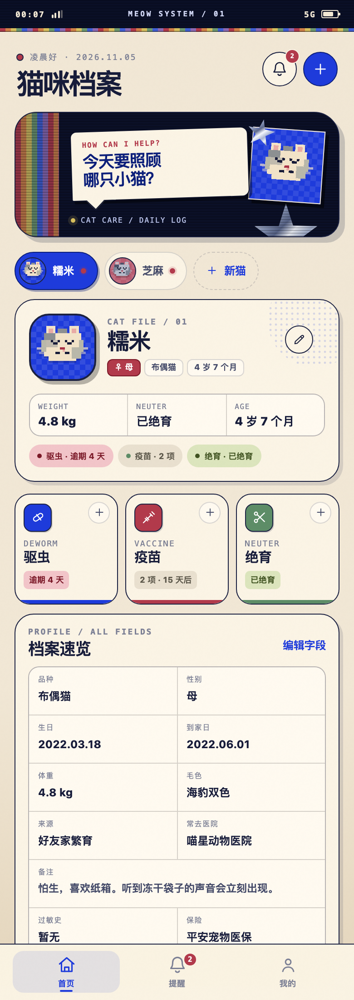

# 喵档 · MEOW SYSTEM

iOS 风格 + Y2K 拼贴的猫咪档案 App。App 本身仍是单文件 HTML；推荐用自带的本地服务启动，把数据写入电脑上的 `data.json`，电脑和手机共用同一份。

整个项目都保存在 `meow-system/` 文件夹里，不会和其他文件混在一起。

需求规格：[REQUIREMENTS.md](REQUIREMENTS.md)



## 推荐：用本地服务打开

macOS 双击 `start-phone.command`；Linux 用 `./start-phone.sh`（见下面的 Linux 部分）。它会：

- 启动本地服务 `server.py`
- 自动打开 Mac 浏览器
- 把数据写入 `meow-system/data.json`
- 在终端打印手机访问地址

之后每次修改都会自动写入 `data.json`；重新打开时会先读取它，所以看到的是已经更新过的档案。

如果 `data.json` 还不存在：

- 页面会先读取当前浏览器里的数据。
- 如果浏览器里是**非示例数据**，会自动写入 `data.json`。
- 如果只是示例数据，不会自动写入；第一次修改后再创建。
- 如果你在多台设备上都用过，先用**数据最新的那台**打开一次，让它成为 `data.json` 的初始数据。

## 直接打开 HTML（浏览器本地模式）

也可以直接双击 `meow-system.html`，或在浏览器打开。这种模式不需要服务，但数据只存在当前浏览器的 `localStorage` 里，**不会写入 `data.json`**，换浏览器/换设备不会自动同步。

适合临时预览；要长期保存到电脑文件，请用 `start-phone.command` 启动。

手动启动服务也可以：

```bash
cd /Users/cheshire/Documents/deepseek-harness/default-workspace/meow-system
python3 server.py 8080
# 浏览器打开 http://127.0.0.1:8080/meow-system.html
```

## 在手机上使用

1. Mac 和 iPhone 连接同一个 Wi-Fi，或者让 Mac 连接 iPhone 的个人热点。
2. macOS 双击 `start-phone.command`；Linux 在终端运行 `./start-phone.sh`。保持窗口开着。
3. 在 iPhone Safari 打开终端里打印的地址，例如：

   ```text
   http://172.20.10.4:8080/meow-system.html
   ```

   如果 IP 地址打不开，再试另一个 `.local` 地址：

   ```text
   http://CheshiredeMacBook-Air.local:8080/meow-system.html
   ```

4. 想更像 App：Safari → 分享 → 添加到主屏幕。

手机和电脑访问的是同一个 `data.json`。如果在一台设备上改完，另一台设备刷新页面就能看到。不要在两台设备上同时编辑，保存采用“后写入覆盖”。

## Linux / 非 macOS

`start-phone.command` 是 macOS 专用的（依赖 `ipconfig`、`scutil`、`pbcopy`、`open` 和 Finder 双击），Linux 不能直接运行。

Linux 使用同一目录下的 `start-phone.sh`（需要 Python 3，可先运行 `python3 --version` 检查）：

```bash
cd /path/to/meow-system
chmod +x start-phone.sh
./start-phone.sh
```

它会：

- 自动检测局域网 IPv4
- 自动选择空闲端口（8080 → 8088 → 8000 → 8008）
- 打印电脑和手机访问地址
- 启动同一个 `server.py`，数据仍然写入当前目录的 `data.json`

常用选项：

```bash
PORT=8090 ./start-phone.sh     # 手动指定端口
NO_OPEN=1 ./start-phone.sh     # 无桌面环境 / 不自动打开浏览器
python3 server.py 8080         # 不通过脚本，直接启动
```

在无桌面的 Linux 服务器上建议用 `NO_OPEN=1`。手机和 Linux 需要处于同一 Wi-Fi / 热点，并放行对应 TCP 端口：

```bash
# Ubuntu / Debian
sudo ufw allow 8080/tcp

# Fedora / RHEL
sudo firewall-cmd --add-port=8080/tcp --permanent
sudo firewall-cmd --reload
```

如果从 Mac 迁移到 Linux，请把**整个 `meow-system/` 文件夹**一起复制，尤其是 `data.json`。这样 Linux 启动后会直接读取原有档案。

## 数据文件

- `data.json` — 当前档案数据，自动生成；明文 JSON，注意隐私
- `data.json.bak` — 上一次保存的自动备份
- 也可以在「我的 → 导出 JSON 备份」手动下载一份

迁移或备份时，复制 `data.json`，或使用 App 内的导出/导入即可。不要同时运行两个会写同一个 `data.json` 的服务。

## 已实现

- 多猫档案，首页横向切换
- 首页「档案速览」展示所有非空字段，包括自定义字段
- 基础字段自由添加 / 删除 / 重命名
- 新增猫咪的默认字段不含芯片号；已有非空芯片内容会保留
- 驱虫、疫苗记录，按种类分别计算下次日期
- 绝育状态、手术日期、医院、费用、术前检查、备注
- 一键完成并自动生成下一次记录，支持撤销
- 左滑删除记录；编辑记录弹窗内也有删除入口
- 应用内提醒：逾期、今天、7 天内、之后、待安排
- 本地 `data.json` 持久化 + JSON 导出 / 导入
- 浅色 / 深色 / 跟随系统
- 预置「糯米」「芝麻」两只示例猫
- 适配 320px、390px 手机宽度和桌面居中预览
- 无登录、无云同步、无社区

## 目录

- `meow-system.html` — 最终交付的单文件
- `server.py` — 本地服务 + `data.json` 读写接口
- `start-phone.command` — macOS 启动器
- `start-phone.sh` — Linux / 通用终端启动器
- `REQUIREMENTS.md` — 需求规格说明书
- `data.json` — 自动生成的数据文件
- `screens/` — 界面截图
- `src/app.js`、`src/styles.css`、`src/shell.html` — 可维护源码
- `build.mjs` — 把源码内联成单文件

修改源码后重新构建：

```bash
node build.mjs
```
