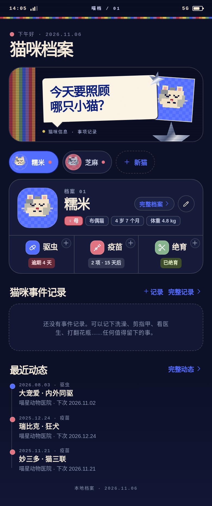

# 喵档 · MEOW SYSTEM

iOS 风格 + Y2K 拼贴的猫咪档案 App。App 本身仍是单文件 HTML；推荐用自带的本地服务启动，把数据写入电脑上的 `data.json`，电脑和手机访问同一份数据。线上站点（`meow-system.site`）是同一套 App，但读写的是服务器上自己的 `data.json`，和本地文件互不同步。

整个项目都保存在 `meow-system/` 文件夹里，不会和其他文件混在一起。




## 现有页面

底部三个标签页：

| 标签 | 内容 |
| --- | --- |
| 首页 | 拼贴标语卡 → 猫咪切换（含「新猫」）→ 档案卡（档案卡与驱虫/疫苗/绝育合并在同一个外框内）→ 猫咪事件记录（最近 3 条）→ 最近动态（最近 3 条） |
| 提醒 | 按「全部 / 驱虫 / 疫苗 / 绝育」筛选，按「逾期 / 今天 / 7 天内 / 之后 / 待安排」分组 |
| 我的 | 系统面板（猫咪数、记录数、存储位置、备份方式）、外观切换、数据管理 |

**档案卡**：头像、`档案 NN` 编号、姓名、「完整档案」入口和编辑按钮、标签行（性别、品种、年龄、体重）。卡片下半部分是驱虫 / 疫苗 / 绝育三格，图标、标题和状态标签在各自格子里水平居中，右上角是小号 `+` 快速录入，点整格进入档案页对应区块。

**档案页**：顶部导航、猫咪信息卡、猫咪事件记录、驱虫记录、疫苗记录、绝育信息；记录支持左滑删除，编辑弹窗内也有删除入口；底部可删除这只猫。

## 推荐：用本地服务打开

macOS 双击 `start-phone.command`；Linux 用 `./start-phone.sh`（见下面的 Linux 部分）。它会：

- 启动本地服务 `server.py`
- 自动打开浏览器
- 通过 `/api/data` 读写 `meow-system/data.json`
- 在终端打印手机访问地址

之后每次修改都会自动写入 `data.json`；重新打开时会先读取它，所以看到的是已经更新过的档案。

如果 `data.json` 还不存在：

- 页面会先读取当前浏览器里的数据。
- 如果浏览器里是**非示例数据**，会自动写入 `data.json`。
- 如果只是示例数据，不会自动写入；第一次修改后再创建。
- 如果你在多台设备上都用过，先用**数据最新的那台**打开一次，让它成为 `data.json` 的初始数据。

## 直接打开 HTML（浏览器本地模式）

也可以直接双击 `meow-system.html`，或在浏览器打开。这种模式不需要服务，但数据只存在当前浏览器的 `localStorage` 里，**不会写入 `data.json`**，换浏览器/换设备不会自动同步。

适合临时预览；要长期保存到电脑文件，请用启动脚本。

手动启动服务也可以：

```bash
cd /home/ubuntu/.openclaw/workspace/agent-43a280a3/meow-system
python3 server.py 8080
# 浏览器打开 http://127.0.0.1:8080/meow-system.html
```

服务端行为：

- `GET /api/health` — 健康检查，返回 `{"ok": true, "server": "meow-system"}`
- `GET /api/data` — 读取 `data.json`，文件不存在时返回 `{"ok": true, "data": null}`
- `POST /api/data` — 校验后原子写入（临时文件 + `os.replace`），写入前把旧文件备份为 `data.json.bak`；请求体上限 20MB
- `/` 和空路径会 302 跳到 `/meow-system.html`；目录浏览已关闭，源码、日志、备份一律不对外

## 在手机上使用

1. 电脑和手机连接同一个 Wi-Fi，或者让电脑连接手机的个人热点。
2. macOS 双击 `start-phone.command`；Linux 在终端运行 `./start-phone.sh`。保持窗口开着。
3. 在手机浏览器打开终端里打印的地址，例如：

   ```text
   http://172.20.10.4:8080/meow-system.html
   ```

4. 想更像 App：Safari → 分享 → 添加到主屏幕。

手机和电脑访问的是同一个 `data.json`。如果在一台设备上改完，另一台设备刷新页面就能看到。不要在两台设备上同时编辑，保存采用“后写入覆盖”。

## Linux / 非 macOS

`start-phone.command` 是 macOS 专用的（依赖 `ipconfig`、`scutil`、`pbcopy`、`open` 和 Finder 双击），Linux 不能直接运行。

Linux 使用同一目录下的 `start-phone.sh`（需要 Python 3，可先运行 `python3 --version` 检查）：

```bash
cd /path/to/meow-system
chmod +x start-phone.sh
./start-phone.sh
```

它会：

- 自动检测局域网 IPv4
- 自动选择空闲端口（8080 → 8088 → 8000 → 8008）
- 打印电脑和手机访问地址
- 启动同一个 `server.py`，数据仍然写入当前目录的 `data.json`

常用选项：

```bash
PORT=8090 ./start-phone.sh     # 手动指定端口
NO_OPEN=1 ./start-phone.sh     # 无桌面环境 / 不自动打开浏览器
python3 server.py 8080         # 不通过脚本，直接启动
```

Server 端环境变量：

```bash
PORT=8080                      # 监听端口（命令行参数优先）
MEOW_HOST=0.0.0.0              # 监听地址，默认 0.0.0.0
MEOW_DATA=/path/to/data.json   # 数据文件位置，默认当前目录
```

在无桌面的 Linux 服务器上建议用 `NO_OPEN=1`。手机和服务器需要处于同一网络，并放行对应 TCP 端口：

```bash
# Ubuntu / Debian
sudo ufw allow 8080/tcp

# Fedora / RHEL
sudo firewall-cmd --add-port=8080/tcp --permanent
sudo firewall-cmd --reload
```

如果从 Mac 迁移到 Linux，请把**整个 `meow-system/` 文件夹**一起复制，尤其是 `data.json`。这样 Linux 启动后会直接读取原有档案。

## 线上部署（本机现网形态）

当前这台机器上，App 以 systemd 常驻 + nginx 反代的形式运行：

- 访问地址：<https://meow-system.site/>（根路径 302 到 `/meow-system.html`，证书由 Certbot 续期）
- `meow-system.service`：`python3 server.py 9090`，`MEOW_HOST=127.0.0.1`，日志追加到 `logs/meow.log`，`Restart=always`
- `nginx`：`meow-system`（443 HTTPS）+ `meow-system-altport`（8080 备用 HTTP），只放行 `/meow-system.html`、`/api/health`、`/api/data` 和根路径跳转，其余返回 404
- `logrotate`：`logs/*.log` 按天轮转，保留 14 份，10M 触发

模板都放在 `.deploy/` 里，修改后需要同步到 `/etc/nginx/sites-available/` 与 `/etc/systemd/system/` 并 reload。注意：服务端只托管单文件 App，源码目录本身不对外暴露。

## 数据文件

- `data.json` — 当前档案数据，自动生成；明文 JSON，注意隐私（已在 `.gitignore` 中）
- `data.json.bak` — 上一次保存的自动备份
- 也可以在「我的 → 导出 JSON 备份」手动下载一份，或用「导入 JSON 备份」覆盖导入
- 「我的」里还有「恢复示例数据」和「清空全部数据」两个入口，都有二次确认

迁移或备份时，复制 `data.json`，或使用 App 内的导出/导入即可。不要同时运行两个会写同一个 `data.json` 的服务。

## 已实现

- 多猫档案，首页横向切换，`+ 新猫` 添加
- 档案卡与驱虫/疫苗/绝育合并为一张卡片，内部用分隔线分区，三格内容居中
- 基础字段自由添加 / 删除 / 重命名，支持自定义字段
- 新增猫咪的默认字段为品种、性别、生日、到家日、体重、毛色、来源、常去医院、备注；不含芯片号，已有非空芯片内容会保留
- 驱虫、疫苗记录，按种类分别计算下次日期（逾期 / 今天 / 7 天内 / 之后）
- 绝育状态、手术日期、医院、费用、术前检查、备注；「计划中」显示为待安排
- 猫咪事件记录（时间、标题、经过），首页最近 3 条，档案页全量
- 一键完成并自动生成下一次记录，支持撤销
- 左滑删除记录；编辑记录弹窗内也有删除入口
- 应用内提醒：逾期、今天、7 天内、之后、待安排；底部「提醒」标签带待办角标
- 本地 `data.json` 持久化（`/api/data`）+ 浏览器 `localStorage` 兜底 + JSON 导出 / 导入
- 浅色 / 深色 / 跟随系统（设置里为「自动 / 浅色 / 深色」）
- 预置「糯米」「芝麻」两只示例猫
- 适配 320px、390px 手机宽度和桌面居中预览
- 无登录、无云同步、无社区

## 目录

- `meow-system.html` — 最终交付的单文件（由 `build.mjs` 生成，不要手改）
- `server.py` — 本地服务 + `data.json` 读写接口
- `start-phone.command` — macOS 启动器
- `start-phone.sh` — Linux / 通用终端启动器
- `data.json` — 自动生成的数据文件（不入库）
- `screens/` — 界面截图
- `src/app.js`、`src/styles.css`、`src/shell.html` — 可维护源码（拼贴背景与像素猫全部是内联 SVG，无外链图片）
- `build.mjs` — 把源码内联成单文件
- `.deploy/` — systemd / nginx / logrotate 部署模板
- `logs/` — 运行日志（不入库）
- `DEPENDENCIES.md` — 依赖与部署环境说明

修改源码后重新构建：

```bash
node build.mjs
```

改完 `src/` 里的文件后，务必重新构建 `meow-system.html`，否则线上和本地打开的还是旧版本。
